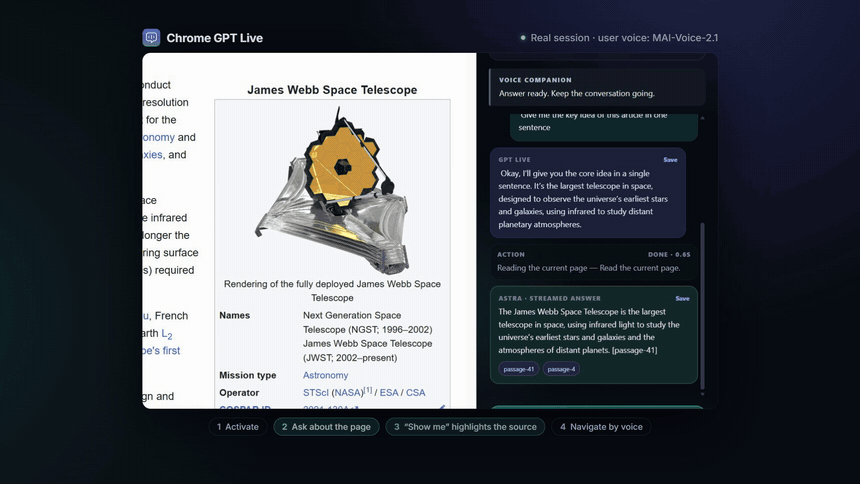
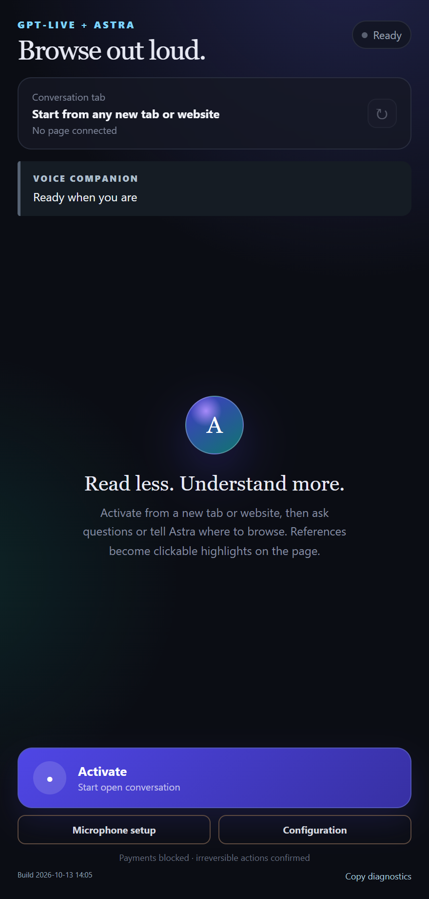
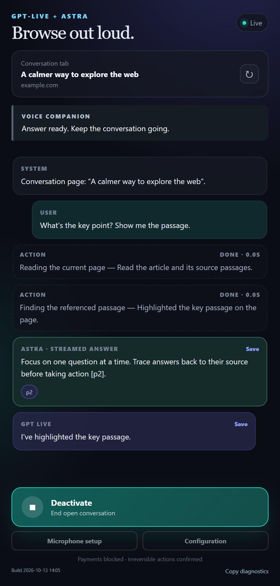
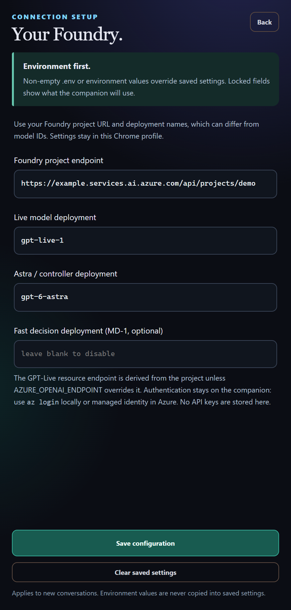

<p align="center">
  
</p>

<h1 align="center">Chrome GPT Live</h1>

<p align="center">
  <strong>Browse out loud. Read less. Understand more.</strong>
</p>

<p align="center">
  Voice conversations. Page-aware answers. Browser actions you can follow.
</p>

<p align="center">
  <a href="#demo">Demo</a> &middot;
  <a href="#screenshots">Screenshots</a> &middot;
  <a href="#setup">Quick start</a> &middot;
  <a href="#configure-your-foundry-connection">Configuration</a> &middot;
  <a href="#safety-model">Safety</a> &middot;
  <a href="#development">Development</a> &middot;
  <a href="#disclaimer--license">License</a>
</p>

Chrome GPT Live is a Manifest V3 side-panel extension that pairs Azure `gpt-live-1`
voice conversations with a `gpt-6-astra` controller deployment. The live model owns the
conversation while Astra receives browser tools for reading, navigating, highlighting,
and acting on the current tab.

> [!IMPORTANT]
> **Example software — use at your own risk.** This repository is a personal, educational reference sample provided **"AS IS"**, without warranties or support of any kind, and is not an official product. You are solely responsible for how you configure, deploy, and use this software—including any automated browser actions performed on third-party websites, compliance with applicable laws and website Terms of Service, data sent to your configured model deployments, and any cloud usage costs incurred. The author assumes no responsibility or liability for any misuse, damages, or consequences resulting from its use. See [Disclaimer & License](#disclaimer--license) and [SECURITY.md](SECURITY.md).

## Demo

<p align="center">
  <a href="docs/media/chrome-gpt-live-demo.mp4">
    
  </a>
</p>

<p align="center">
  <a href="docs/media/chrome-gpt-live-demo.mp4"><strong>▶ Watch the full demo with sound (72 s, MP4)</strong></a>
</p>

In one voice session on Wikipedia, the user asks for the key idea of the article, says
**"Show me on the page"** to get the source passage highlighted, then asks to open the
Hubble article, which MD-1 finds and clicks.

*Recorded live in Chrome with the built extension against Microsoft Foundry deployments
of `gpt-live-1`, `gpt-6-astra`, and MD-1. The user's voice is synthesized with
[MAI-Voice-2.1](https://learn.microsoft.com/azure/ai-services/speech-service/mai-voices).
Waits for model responses are trimmed, and sped-up segments are labeled in the video.*

## Screenshots

<table>
  <tr>
    <th>Ready to talk</th>
    <th>Answers with context</th>
    <th>Your Foundry connection</th>
  </tr>
  <tr>
    <td>
      <a href="docs/images/sidepanel-ready.png">
        
      </a>
    </td>
    <td>
      <a href="docs/images/sidepanel-conversation.png">
        
      </a>
    </td>
    <td>
      <a href="docs/images/foundry-configuration.png">
        
      </a>
    </td>
  </tr>
  <tr>
    <td>Start from a new tab or a website.</td>
    <td>Follow browser actions and jump to source passages.</td>
    <td>Use your own project and deployment names.</td>
  </tr>
</table>

*Captured from the built React side panel. Conversation content and Foundry settings
are illustrative; no live Azure session or credentials are shown. Click an image
to view it at full size.*

## What you can do

| Capability | How it helps |
| --- | --- |
| **Talk naturally** | Start an open voice conversation from a new tab or website, with WebRTC audio and an on-screen transcript. |
| **Understand the page** | Ask about articles, headings, tables, or visible controls; follow citation buttons to highlighted source passages. |
| **Read PDFs** | Ask about PDFs open in Chrome's viewer, including local files. Answers cite page numbers, and citations jump to the page. |
| **Browse with Astra** | Navigate, search, click, and inspect the page visually using browser tools scoped to the conversation. |
| **Follow the work** | See activity states, elapsed time, browser action results, and Astra's streamed public answers in the timeline. |
| **Stay in control** | Confirm irreversible actions, keep payment actions blocked, and save useful insights locally. |

Try saying **"Summarize this article"**, **"Show me the passage that explains this"**,
or **"Open a website and help me find what I need."**

## Architecture

- **Chrome extension**: React side panel, WebRTC audio, transcript/action timeline,
  article extraction, citations, highlights, screenshots, and browser actions.
- **Companion service**: Fastify broker that authenticates with Microsoft Entra ID,
  creates GPT-Live WebRTC sessions, and sends screenshots to Astra when visual
  inspection is requested. The extension starts it on demand through a
  [Chrome native messaging](https://developer.chrome.com/docs/extensions/develop/concepts/native-messaging)
  host, so no terminal needs to stay open.
- **Shared package**: Typed action, page-context, and broker API contracts.

The browser never receives a Foundry credential. Local development uses
`DefaultAzureCredential` (`az login`); Azure hosting uses managed identity.

For an implementation-level comparison with Jev Ultrafast, including architecture
and execution-flow diagrams, see [Browser agent comparison](docs/browser-agent-comparison.md).

## Prerequisites

- [Node.js 22.12+ or 24+](https://nodejs.org/en/download)
- Chrome 116 or newer
- [Azure CLI](https://learn.microsoft.com/cli/azure/install-azure-cli)
- `Cognitive Services OpenAI User` access to the Foundry resource
- A GPT-Live deployment and an Astra-compatible Responses controller deployment

## Setup

From the cloned repository, run one command in an interactive terminal:

```powershell
npm run setup
```

The guided installer checks prerequisites and port availability, verifies an Azure
sign-in can obtain a Cognitive Services token, and offers
[browser sign-in with `az login`](https://learn.microsoft.com/cli/azure/authenticate-azure-cli-interactively)
if needed. After your approval, it installs locked dependencies with `npm ci`,
builds, and installs a **self-contained copy** of the extension and its companion
in your user profile (see [Installed files](#installed-files)). It then starts the
companion in the background, shows the Chrome steps, and exits. It can optionally
open the extension folder and Chrome's extensions page on Windows or macOS.
Other platforms receive the same instructions for opening them manually.
Run `npm run setup -- --help` to view requirements without making changes.

After setup, the extension no longer depends on the repository: you can move or
delete the clone, and no terminal needs to stay open. The installed companion only
needs Node.js (at the same install path) and your Azure CLI sign-in.

No `.env` file is required. Saved Chrome settings are preserved; configure Foundry
in the extension as described below. If `apps\server\.env` exists, setup copies it
next to the installed companion. Setup verifies Azure authentication, not Foundry
permissions or whether your deployments exist. If a prerequisite is missing,
install it using the links above, reopen the terminal, and rerun setup. If port
4317 is used by another program, stop it before retrying; a running Chrome GPT
Live companion is replaced automatically.

### Finish in Chrome

Chrome requires user approval to load an unpacked extension; the installer does
not bypass that approval or microphone permissions.

1. Open `chrome://extensions` and turn on **Developer mode**.
2. If you previously loaded Chrome GPT Live from the repository
   (`apps\extension\dist`), click **Remove** on that card.
3. Click **Load unpacked** and select the installed `extension` folder, for example
   `%LOCALAPPDATA%\chrome-gpt-live\extension` on Windows. The installer prints the
   full path. If it is already loaded from there, click **Reload** instead.
4. Open **Chrome GPT Live** from Chrome's Extensions menu. Pin it to make it easy
   to open again.
5. Open **Configuration** and save your Foundry project endpoint and deployment
   names.
6. Complete **Microphone setup** as described below, then click **Activate**.

Removing an unpacked extension clears its saved settings, so after switching from
a repository-loaded copy, enter your configuration and microphone permission once
more. Reloading or updating the installed copy keeps them.

### Automatic companion start

Setup registers a per-user
[native messaging host](https://developer.chrome.com/docs/extensions/develop/concepts/native-messaging)
(`com.chrome_gpt_live.companion`). When the side panel opens, or a request finds
the companion stopped, the extension asks Chrome to run the host. The host starts
the installed companion in the background and exits once `/health` responds. The
companion keeps running after Chrome closes and uses your Azure CLI sign-in
(`DefaultAzureCredential`), so `az login` is still required.

The manifest includes a fixed public `key` so the unpacked extension always has
ID `iiicmaimehmegmkllfoplagpkkingpfg`, the only origin the host accepts, wherever
it is loaded from.

### Installed files

| Platform | Folder |
| --- | --- |
| Windows | `%LOCALAPPDATA%\chrome-gpt-live` |
| macOS | `~/Library/Application Support/chrome-gpt-live` |
| Linux | `~/.local/state/chrome-gpt-live` |

The folder contains `extension` (the unpacked extension to load in Chrome),
`companion.mjs` (the companion bundled into a single file), `native-host.mjs` and
its launcher, `companion.log`, and an optional `.env`. On Windows the host is
registered under `HKCU\Software\Google\Chrome\NativeMessagingHosts`; on macOS and
Linux its manifest is in Chrome's `NativeMessagingHosts` folder.

| Task | Command |
| --- | --- |
| Update | Pull the repository, rerun `npm run setup` (or `npm run build` then `npm run companion:install`), and click **Reload** at `chrome://extensions`. |
| Stop the companion | `npm run stop`, or `node "%LOCALAPPDATA%\chrome-gpt-live\native-host.mjs" stop` without the repository. It starts again the next time it is needed. |
| Start it manually | `node "%LOCALAPPDATA%\chrome-gpt-live\native-host.mjs" start` |
| Uninstall | `npm run companion:uninstall`, or `node "%LOCALAPPDATA%\chrome-gpt-live\native-host.mjs" uninstall`, then **Remove** the extension at `chrome://extensions`. |

On macOS and Linux, use the folder from the table above instead of
`%LOCALAPPDATA%\chrome-gpt-live`. The launcher pins the Node.js executable that ran
setup; rerun setup if you move or reinstall Node.js elsewhere.

To run the companion from the repository in a terminal instead (for example while
developing), stop the background one with `npm run stop`, then run:

```powershell
npm start
```

`npm start` uses the same local settings as the installed companion:
`127.0.0.1:4317` and development authentication (`DefaultAzureCredential`,
including Azure CLI). These local `HOST`, `PORT`, and `NODE_ENV` values override
environment / `.env` values to match the extension's fixed companion URL. Foundry
and other settings continue to use the existing precedence rules. For Azure
hosting, use the server workspace's build/start commands and production settings
instead.

See Chrome's [unpacked-extension installation guide](https://developer.chrome.com/docs/extensions/get-started/tutorial/hello-world#load-unpacked)
for additional details.

### Manual developer setup

If you prefer to manage builds and watchers yourself:

```powershell
az login
npm install
npm run build
npm run dev:server
```

In a second terminal:

```powershell
npm run dev:extension
```

Follow **Finish in Chrome** above, but load `apps\extension\dist` so Chrome picks up
your rebuilds. Copy `apps\server\.env.example` to `apps\server\.env` only if you
want companion-side overrides or advanced settings. If an automatically started
companion is already using port 4317, run `npm run stop` before
`npm run dev:server`. Run `npm run companion:install` after a build if you want
auto-start without the guided installer.

After rebuilding, **Deactivate**, click **Reload** on the Chrome GPT Live card at
`chrome://extensions`, refresh the article tab, and **Activate** again.
If Chrome reports `Could not load file: 'assets/content.ts-loader-....js'`, its
loaded manifest still refers to a previous build. The same reload sequence fixes
this; restarting the companion service alone does not. Production builds use
stable asset filenames to reduce stale-manifest failures during local rebuilds.

### Microphone permissions

Before the first conversation, click **Microphone setup** in the side panel.
In the new browser tab, click **Allow microphone** and approve Chrome's prompt.
Setup immediately releases the microphone without recording or transmitting audio.
Close the setup tab, return to an article or a new Chrome tab, and click **Activate**.
If you activate before granting access, the extension opens setup automatically.

You can start a conversation on Chrome's built-in New Tab page or `about:blank`
without loading a website. Talk normally or ask Astra to open a site. The extension
does not inject scripts into Chrome's internal page or read its shortcuts; browsing
tools become available after navigating to a regular website. Other protected pages,
such as Chrome settings or another extension's pages, remain unsupported starting points.

Chrome can automatically dismiss microphone prompts opened from a side panel.
If you see "Permission dismissed", reload the extension on `chrome://extensions`
after rebuilding and use the normal-tab setup flow above. If access remains blocked,
check `chrome://settings/content/microphone` and Windows **Privacy & security >
Microphone**, including desktop-app access.

### Configure your Foundry connection

Click **Configuration** in the side panel before your first conversation. Enter
your Foundry **project endpoint**, **Live model deployment name**,
**Astra / controller deployment name**, and optionally the **Fast decision
deployment (MD-1)**, then click **Save configuration**.
Deployment names can differ from model IDs. No personal resource is preconfigured.

The project endpoint has this shape:

```text
https://your-resource.services.ai.azure.com/api/projects/your-project
```

Settings are stored in `chrome.storage.local` for the current Chrome profile, not
in repository files or Chrome Sync. Deactivate an active conversation before editing.
Live delegation, visual inspection, and experimental controller requests use the
same session configuration snapshot.

**Precedence: non-empty companion environment / `.env` values > saved settings >
default deployment names.** An existing `.env` file does not disable the UI;
only fields with non-empty environment values are locked and labeled. The panel
never copies those environment values into saved settings. Clear saved settings
does not modify `.env`.

The GPT-Live resource endpoint is derived from the effective project endpoint.
Set `AZURE_OPENAI_ENDPOINT` in `.env` if your live deployment uses a different
resource. Project URLs must use HTTPS on `*.services.ai.azure.com` with an
`/api/projects/<project>` path; live resource URLs must use HTTPS on
`*.openai.azure.com`. Arbitrary hosts, embedded credentials, query strings, and
non-HTTPS endpoints are rejected.

The signed-in identity needs **Cognitive Services OpenAI User** on the configured
resource, plus project access. Run `az login` on the machine hosting the companion.
The configuration panel does not collect keys or Azure credentials.

Keep local `.env` files private. They, generated builds, dependency folders, and
browser diagnostic artifacts are ignored by Git. `.env.example` contains only
generic placeholders.

### Experimental MD-1-first browser control

The default remains managed GPT-Live-to-Astra delegation. In **Configuration**,
the experimental controller option can prefer MD-1 for grounded HTML clicks,
scrolls, and bounded waits, then automatically hand off unsupported or uncertain
work to Astra. It does not add CDP/debugger permissions or native-select support.
Typing, reading, PDFs, and visual analysis retain the existing Astra tools.
**Stop browser task** cancels client-mode browser work without ending the voice
conversation. It cannot undo input already delivered to a page.

Real-task activation is release-locked. A decision deployment and the opt-in are
not sufficient: the companion must also have
`MD1_CLIENT_DELEGATION_VERIFIED=true`. Leave that setting **false** until an
authorized operator has checked the deployed [GPT-Live client-delegation
contract](https://learn.microsoft.com/azure/foundry/openai/how-to/gpt-live-delegation).
This flag is an operator attestation, not an automatic live test or a claim of
reliable transcript completion. A locked/unconfigured option visibly stays on
managed Astra. `BROWSER_CONTROL=astra` forces the normal mode; non-empty
`BROWSER_CONTROL` overrides the saved controller option.

For the release check, use a dedicated client-delegation session without browser
execution handlers, synthetic/non-sensitive speech, and no real site actions.
Verify that the deployment supplies timed transcript fragments and correlated
client delegation IDs; test late/interleaved fragments, missing context, duplicate
events, cancellation, and bounded result appends. Never infer a complete command
from silence or one fragment. Authorize any billable calls separately. Then test
only reversible fixture tasks before real sites. These live checks and matched
latency/cost measurements have **not** been run as part of this implementation.

The client runs at most eight fast action attempts, sixteen MD-1 requests, three
no-progress waits, and sixty seconds of fast work. Astra fallback is limited to
sixteen response rounds and sixteen tool attempts. It retains completed/uncertain
history, never retries uncertain input automatically, and revalidates the exact
target after an approval. Simple observed checkbox/menu/scroll states and grounded
destination URLs can verify fast completion; other `DONE` decisions go to Astra.
Initial transcript routing is deliberately conservative and recognizes explicit
English interaction commands; other requests go to Astra.

Expiry is enforced at the browser-message and document boundaries, not just while
waiting for a model. A document-local attempted-node ledger prevents same-task
Astra fallback from re-clicking a completed/uncertain fast target after cancellation;
it is not an exactly-once guarantee across document replacements.

Deactivate before changing modes. To roll back, select **Managed Astra**, or set
`BROWSER_CONTROL=astra`, then start a new conversation. See the
[comparison, diagrams, implementation, and evaluation boundaries](docs/browser-agent-comparison.md#6-experimental-md-1-first-controller).
No model-backed speedup is claimed.

### GPT-Live authentication troubleshooting

The broker requests an Entra token for `https://cognitiveservices.azure.com/.default`
and sends `Authorization: Bearer <access-token>` to `/openai/v1/live/sessions` on the
Azure OpenAI resource endpoint. A `401` alone does not establish missing RBAC:
check the authorization scheme, token audience, and resource endpoint first.
Do not copy masked authorization placeholders from documentation into requests.
Keep credentials on the broker and never log access tokens.

### Browser tool continuations

GPT-Live streams Astra's function calls before the complete pending-call set is
ready. The extension collects calls by delegation and response, waits for
`response.completed`, and executes them sequentially (including confirmations).
It submits one output for every call before sending a single `response.create`.
Tool failures and declined confirmations are returned as failure outputs; stopping
a session discards pending work so old results cannot enter a new conversation.

Large page snapshots can exceed GPT-Live's backend input limit (32 KiB / 128 items).
When an oversized tool result is rejected, a following continuation produces the
misleading secondary error **"Submit the pending function call outputs before
response.create."** The client now bounds each complete UTF-8 tool event to 6,000
bytes and all pending tool outputs to 24,000 bytes, preserving JSON, citation IDs,
selectors, and complete retained URLs. Context is explicitly labeled when abbreviated.
Use focused `get_page_context` queries to retrieve passages outside that snapshot.
The pending-output budget renews on continuation; it is not a whole-conversation quota.

The first service error is preserved, and fatal errors stop microphone capture and
leave the UI disconnected instead of silently abandoning tools while showing Live.
**Copy diagnostics** copies only bounded, in-memory protocol metadata (event types,
IDs, byte counts, and error categories), not transcripts, page contents, URLs,
settings, credentials, or tool arguments. The footer's build time helps identify
an extension that needs reloading. Broker HTTP logs alone do not contain browser
WebRTC model events.

### Search and response feedback

The activity card shows connecting, thinking, browser actions, answering, and
confirmation states. Timed operations show elapsed seconds and a hint after eight
seconds; actions appear when they start, and Astra's public answer streams into
the timeline as it arrives, without waiting for spoken playback. Private reasoning is not shown.

Navigation waits for the new page and returns its context in the same tool result.
Page context includes visible control selectors, so Astra can target real search
fields instead of guessing. Clearly identified GET search forms can be submitted
without confirmation; ambiguous and non-search submissions still require approval.
For a search field without a form, Astra must type with `submit=false`, then use
the site's visible search control instead of claiming that typing alone submitted it.

Requests to show or locate information invoke a highlight tool on the web page,
not just a spoken explanation. Passage IDs remain stable as content moves, exact
text can recover stale references, and headings, short passages, tables, and ordinary
pages without article wrappers are supported. Highlights scroll into view and remain
until another passage is highlighted or **Escape** is pressed on the page.

### Fast clicking with Microsoft Decision (MD-1)

For simple clicks and link navigation, Astra calls `find_and_click` with a short
goal instead of reading the full page and choosing a selector itself. The content
script lists up to 30 visible, enabled controls. Payment controls and payment links
are never listed. The companion then asks the
[Microsoft-Decision-1](https://learn.microsoft.com/azure/foundry/foundry-models/how-to/use-foundry-models-microsoft-decision)
deployment a single `choice` question that includes a `none` option, sent to
`https://<resource>.services.ai.azure.com/providers/microsoft/v1/systemone` with the same Entra token.

- **Confident** (confidence ≥ `DECISION_CONFIDENCE_THRESHOLD`, default `0.7`): the
  element is clicked immediately. Confirmation rules for irreversible actions still
  apply. When the click opens a link, the tool result includes the new page context.
- **Unsure, unavailable, or rate-limited**: nothing is clicked. Astra gets up to eight
  ranked candidates with selectors and decides with the LLM, then calls `click`.

Set the deployment name under **Fast decision deployment (MD-1)** in Configuration,
or set `DECISION_DEPLOYMENT`. MD-1 is optional: with no deployment configured, `find_and_click` is not offered and Astra uses `get_page_context` and `click` as before. If MD-1 is deployed in a different Foundry
resource than GPT-Live and Astra, set `DECISION_PROJECT_ENDPOINT` in the companion `.env`. Typing, searching, and irreversible
actions continue to go through Astra. MD-1 is text-only, returns no rationale,
and has its own rate limit.

Page loading is bounded at 15 seconds, ordinary browser actions at 20 seconds, and
visual inspection at 35 seconds. A timeout does not undo an action already sent to
the browser: inspect the page before retrying. The extension does not blindly
replay actions after a message port closes. CAPTCHA, access restrictions, slow sites,
and model/network latency can still delay or prevent searches.

### PDFs in Chrome's viewer

Chrome shows PDFs in a built-in viewer that extensions can't read directly. When the
conversation tab shows a PDF, the extension downloads the same file again in an
[offscreen document](https://developer.chrome.com/docs/extensions/reference/api/offscreen)
and extracts its text with [PDF.js](https://mozilla.github.io/pdf.js/). The PDF's
title, outline, web links, and text are returned as page context. Passage IDs look like
`pdf-p12-3`, and each citation includes its page number.

- **Highlight**: `highlight` and citation buttons open the cited page using the PDF
  [`#page=` parameter](https://helpx.adobe.com/acrobat/kb/link-html-pdf-page-acrobat.html) and
  a [text fragment](https://developer.mozilla.org/docs/Web/URI/Reference/Fragment/Text_fragments).
  The viewer reloads to jump to the page. Chrome highlights the quote only when it
  finds an exact match, so on some PDFs only the page changes.
- **Not supported in PDFs**: clicking, typing, scrolling, and `find_and_click`. Use
  citations or ask Astra to show a passage instead.
- **Scanned PDFs**: image-only PDFs have no text to extract. Astra uses
  `inspect_viewport` to read the visible page instead. The same fallback applies to
  password-protected or damaged files.
- **Limits**: files up to 50 MB and the first 400 pages. Reading stops after 15 seconds.
  The three most recent PDFs are cached for 10 minutes.
- **Local files**: to use `file://` PDFs, open `chrome://extensions`, choose
  **Details** for Chrome GPT Live, and turn on **Allow access to file URLs**. Without it, the
  side panel explains how to turn it on. Other local file types aren't supported.
- **Links to PDFs**: Astra can open `.pdf` links without asking for download
  confirmation, because Chrome opens them in the viewer. If **Download PDFs** is
  turned on in `chrome://settings/content/pdfDocuments`, Chrome saves those files
  instead of opening them.

PDF reading uses the PDF.js modern build, which targets current Chrome releases.
Update Chrome if PDF reading fails while web pages still work.

## Safety model

- Autonomous actions are limited to the conversation tab and tabs opened by the
  assistant.
- Payment fields and payment/checkout actions are always blocked.
- Sending, publishing, deleting, account changes, and downloads require confirmation.
- Raw audio, screenshots, and transcripts remain session-only.
- Text from PDFs you discuss, including local files, is sent to your configured
  Foundry deployments just like web page text.
- Bookmarked insights are stored locally in Chrome storage.

## Development

Run these commands from the repository root:

```powershell
npm run typecheck
npm test
npm run build
```

## Environment

See `apps\server\.env.example`. For Azure hosting, set `NODE_ENV=production` and
optionally `AZURE_CLIENT_ID` for a user-assigned managed identity.

`ASTRA_REASONING_EFFORT` defaults to `low`, with concise output, to favor interactive
responses. Set it to `medium` or `high` for deeper reasoning at the cost of possible
additional latency, restart the companion service, and start a new conversation.

## Disclaimer & License

This project is published strictly as **educational and experimental example software** to demonstrate voice-driven browser assistance with GPT-Live, Astra, and MD-1. It is provided **"AS IS"**, without warranty of any kind, express or implied, and is not an official or supported product.

By downloading, building, or running this code, you acknowledge that **you are solely responsible for its operation and effects**—including supervising browser actions on websites, respecting third-party Terms of Service and applicable regulations, safeguarding data shared with your model deployments, and covering any Azure / Microsoft Foundry charges. In no event shall the author or copyright holders be liable for any claim, damages, misuse, or other liability arising from or in connection with the software.

Licensed under the [MIT License](LICENSE). For vulnerability reporting and operational security guidance, see [SECURITY.md](SECURITY.md).

