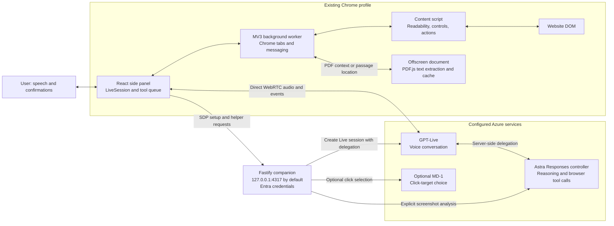
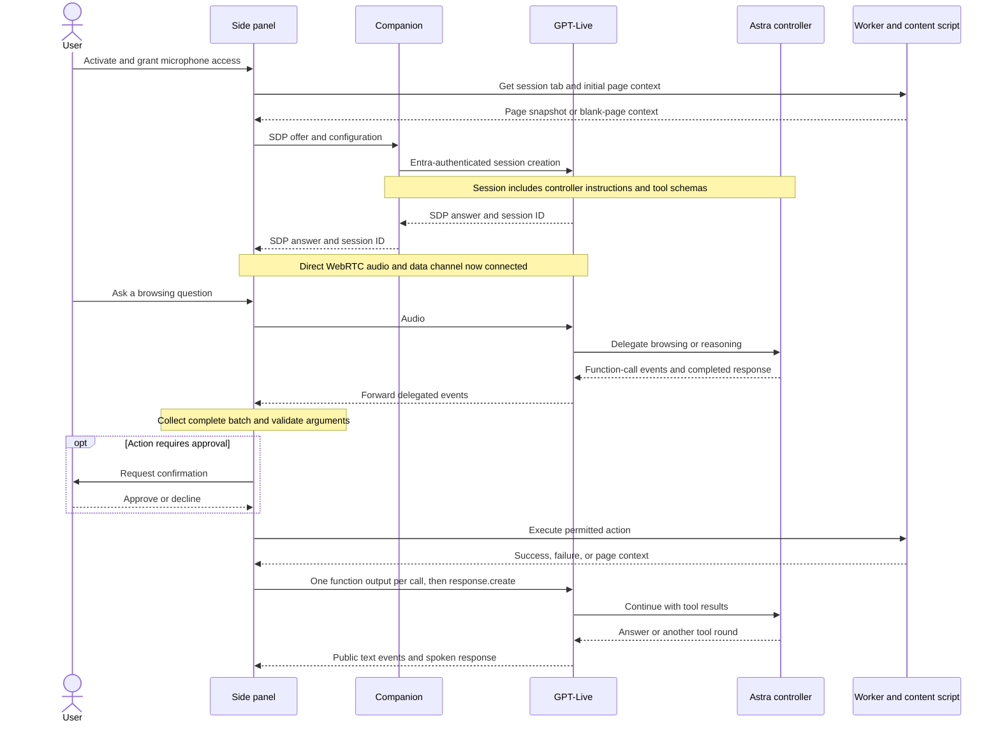
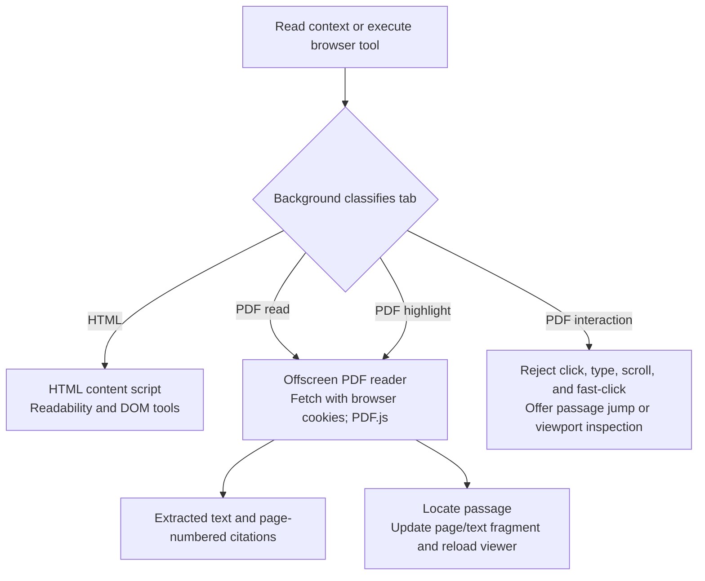
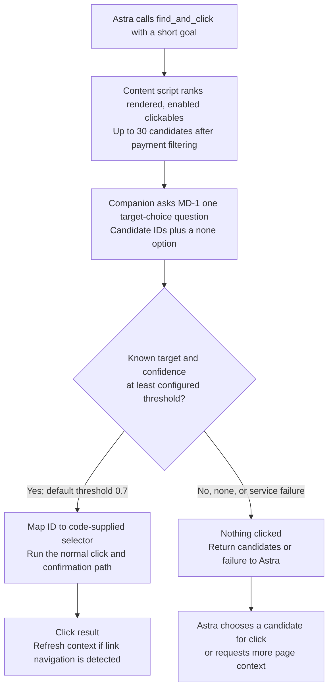
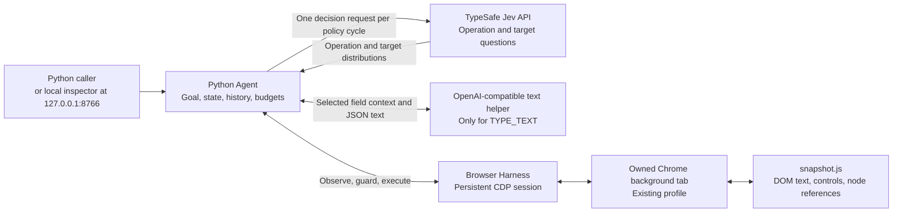
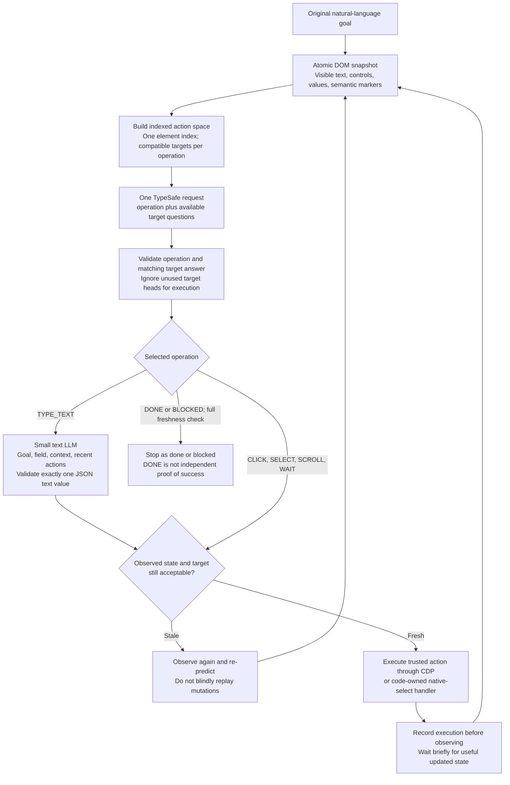
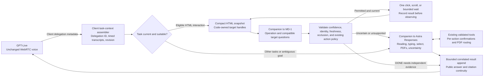
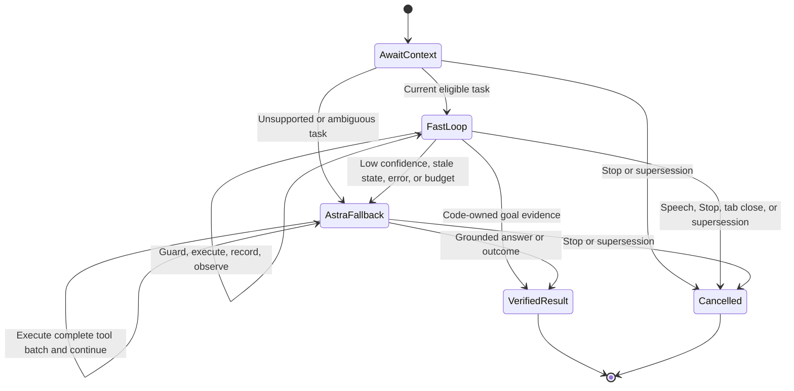

# Chrome GPT Live vs. Jev Ultrafast

## The short answer

**Chrome GPT Live is a voice-first browsing companion. Jev Ultrafast is a
goal-driven browser automation loop optimized around choosing actions.**

This repository combines a conversational model, a general-purpose reasoning
controller, browser tools, and an optional fast click selector. Jev makes a
finite-choice model the main controller: it chooses an operation and an observed
target together, then calls a text-generating LLM only when it needs a field value.

The closest equivalent to Jev here is **the optional MD-1 `find_and_click` path**,
not GPT-Live itself. Both constrain a decision model to code-supplied candidates,
but Jev applies that idea to its whole supported action loop; this plugin applies
it to a click subtask chosen by Astra.

**The biggest improvement opportunity is to make MD-1 the first browser policy,
not just Astra's click helper.** Use GPT-Live's documented client delegation to
route supported tasks directly to MD-1, with Astra as the automatic fallback.
This can remove generative controller turns on click/scroll/wait workflows, but
does not establish a measured speedup. [Section 6](#6-experimental-md-1-first-controller)
details the design, safety gates, implementation sequence, and evaluation.

### Scope and evidence

Reviewed on **2026-10-16**, against these source snapshots:

| Project | Snapshot | What was inspected |
| --- | --- | --- |
| [Chrome GPT Live][plugin-snapshot] | Initial public release (`main`) | Extension, WebRTC/tool loop, companion, configuration, and PDF/offscreen reader. |
| [browser-use/jev-ultrafast][jev-repo] | [`1231850a0bf1a0c0341fe408ef1668dbbfdfac46`][jev-snapshot] | Agent, model adapter, DOM snapshot, CDP executor, inspector, flight checker, and performance report. |

This is a source-based comparison, **not a live head-to-head benchmark**. Model
services are external dependencies; their internal implementations are not visible
in these repositories. The performance figures below are Jev's published results.
Sections 1-5 describe the reviewed baseline implementations. Section 6 describes
the experimental MD-1-first implementation added on this branch, not functionality
in the pinned main snapshot. Automated/mock/browser-fixture evidence is distinct
from deployed-service verification and model-backed performance evidence.

## 1. How this Chrome plugin works

### Components and connections

**The companion is not a proxy for every audio packet or delegated tool call.**
It creates the session using an Entra token and exchanges SDP. The extension then
communicates with GPT-Live over WebRTC. Delegated Astra events arrive through that
same data channel; the browser executes tools locally. The companion is contacted
again for explicit viewport analysis and optional MD-1 decisions.
([Session client][p-live], [broker routes][p-server])

| Component | Responsibility |
| --- | --- |
| React side panel | Activation, microphone connection, transcript, streamed controller answers, action timeline, confirmation UI, and local bookmarks. |
| `LiveSession` | WebRTC audio/data channel, model events, argument validation, tool execution routing, deadlines, and confirmation handling. |
| `ResponsesToolLoop` | Collect complete delegated tool batches, serialize execution, submit outputs, and resume the controller. |
| Background service worker | Tab navigation/creation, HTML/PDF classification, page readiness, content-script messaging/injection, and visible-tab screenshots. |
| Content script | Extract page context, assign passage/control references, click/type/scroll, and highlight source passages. |
| Offscreen PDF reader | Fetch PDF bytes with browser credentials, extract text using PDF.js, cache documents, and locate passages/pages. |
| Fastify companion | Keep Azure credentials server-side; create Live sessions; call Astra for screenshot analysis and MD-1 for click selection. |

Sources: [UI][p-ui], [session client][p-live], [tool queue][p-loop],
[background worker][p-background], [content script][p-content],
[manifest][p-manifest], [broker routes][p-server].

### Startup and one browser-tool round

1. Activation selects the active tab and extracts context. A new/blank tab can
   start a conversation without website context.
2. The side panel acquires the microphone and creates a WebRTC offer. The companion
   authenticates to Azure and creates a Live session configured with an Astra
   Responses delegation, browser tool schemas, and `parallel_tool_calls: false`.
3. GPT-Live handles the voice conversation and can delegate browsing/reasoning to
   Astra. Astra emits named tools with JSON arguments.
4. The extension waits for the delegated response to complete before executing
   its collected calls. It validates arguments, runs calls sequentially, and
   pauses for user confirmation when required.
5. It returns one output for each call, then sends a single `response.create`
   once all outstanding batches are satisfied. Astra can use those results to
   continue browsing or answer; the side panel streams public controller text
   while GPT-Live handles spoken interaction.

The sequence illustrates one permitted action. A declined confirmation returns a
failure output instead of executing the action. Navigation tools return refreshed
page context. Ordinary clicks and typing do not automatically take a complete
post-action snapshot; the controller can request context as needed.
([Tool lifecycle][p-loop], [execution and confirmation][p-live],
[navigation results][p-background])

### What the model sees and can do

Page context is **reading-oriented**, not just an action menu: Mozilla Readability
extracts an article/body excerpt, with headings, links, citations, and control
selectors. Focused `get_page_context` queries retrieve matching passages across a
long page, including content outside the current viewport. Stable passage IDs and
exact-text recovery support actual on-page highlighting.

The tool surface includes `get_page_context`, `navigate`, `click`, `type_text`,
`scroll`, `highlight`, `go_back`, `open_tab`, and `inspect_viewport`; optional MD-1
adds `find_and_click`. Astra supplies arguments such as selectors, text, and URLs.
This is a structured tool API, not an arbitrary JavaScript execution tool.
([Extraction/execution][p-content], [tool definitions and prompts][p-tools])

The extracted snapshot can contain a 12,000-character excerpt, up to 40 citations,
and up to 60 controls, but **that is not all sent unchanged to the model**. Tool
events are compacted to at most 6,000 UTF-8 bytes each, with a 24,000-byte and
100-item pending-output budget between continuations. Abbreviation is explicit,
and the controller is instructed to query for missing passages.
([Extraction limits][p-content], [serialization limits][p-output])

Visual analysis is opt-in: `inspect_viewport` captures the visible conversation
tab, sends its screenshot and refreshed page context to the companion, and makes
a separate Astra Responses request. It is not the default observation mechanism.
([Capture][p-background], [viewport request][p-live], [analysis route][p-server])

### Latest main: PDF reading is a separate execution path

The background worker distinguishes HTML, PDFs, blank tabs, and unsupported pages.
HTML uses the content script. PDFs use an MV3 offscreen document because Chrome's
built-in viewer is not an ordinary page the extension can manipulate.

PDF context includes document metadata and page-numbered citations. `highlight`
locates a passage and opens a `#page=`/text-fragment URL, then reloads the viewer
because same-document fragment updates are ignored. An action result confirms
the page jump/request, **not that Chrome visibly highlighted an exact quote**.
The controller can use viewport inspection when extracted text is unavailable.
([PDF routing][p-background], [PDF context and location][p-pdf-context])

The reader limits downloads to 50 MB and extraction to the first 400 pages, with a
15-second load/extraction deadline and a three-document, ten-minute cache.
Local PDFs require Chrome's **Allow access to file URLs**; other local file types
remain unsupported. Navigation readiness handles PDFs that remain in Chrome's
`loading` state. Keep these behaviors when optimizing HTML actions; repeatedly
extracting PDFs inside a fast action loop would add cost without enabling PDF
click/scroll execution. ([PDF service][p-pdf-service], [extractor][p-pdf-extractor],
[background readiness][p-background])

### The existing fast path: MD-1

MD-1 chooses **where to click**, not the next operation for the entire task.
Astra has already chosen `find_and_click` and supplied its goal. Typing,
reasoning, and task progression still belong to Astra. Without a configured
decision deployment, this tool is not offered at all.
([Candidate construction][p-content], [decision request][p-decision],
[client fallback][p-live], [optional registration][p-tools])

## 2. How Jev Ultrafast works

### Components and connections

Jev is a Python library with an optional local web inspector, **not a Chrome
side-panel extension**. Browser Harness connects it to Chrome through remote
debugging. The executor creates an owned background tab in the existing profile,
keeps one attached CDP session, sets a viewport, and enables focus emulation so
the background tab continues rendering.
([Browser implementation][j-browser], [dependencies][j-project])

The inspector enables screenshots for visualization and exposes separate predict
and act commands. Library calls default to screenshots off. Neither mode sends
screenshots as input to the default Jev decision request: it sends structured
page state. ([Agent options][j-agent], [inspector][j-demo], [model payload][j-model])

### One complete decision cycle

Each observation produces a bounded action space from current DOM nodes. It
offers compatible operations: `CLICK`, `TYPE_TEXT`, `SELECT`, supported scrolling,
`WAIT`, and the terminal choices `DONE`/`BLOCKED`. Up to 250 element-action
candidates are retained before scroll/wait actions are appended; this is not
necessarily 250 distinct elements. Page text is viewport-oriented and capped at
6,000 characters. ([DOM reader][j-snapshot], [action-space construction][j-model])

**Operation and target are not two serial model calls.** One request contains an
operation question and speculative target questions such as `click_target`,
`type_text_target`, and `select_target`, when those operations are available.
Each target question assumes its own operation; it cannot read another question's
answer. The executor uses only the head matching the selected operation.
([Request and validation][j-model], [question instructions][j-questions])

For example, if the answer is `TYPE_TEXT` and target `[3]`, code maps `[3]` to an
observed editable node. A separate OpenAI-compatible helper generates the field
value as `{"text": "London"}`. Code validates the JSON before typing. A click or
select does not need that text-generation call. An interrupted text result is
reused only if the complete helper input is unchanged.
([Text helper][j-model], [cache and handoff][j-agent])

The decision model defaults to `jev-latest`. The example environment configures
`inception/mercury-2.5` through OpenRouter for text generation; without those
overrides, the helper code defaults to `deepseek-chat` at DeepSeek. These are
configuration choices, not additional planner layers.
([Example configuration][j-env], [model defaults][j-model])

### Grounding and execution

The model does not invent CSS selectors or coordinates. A browser-side WeakMap
assigns IDs to real nodes, while a Map retains live references for execution.
Element indices and native-select option indices map back to code-owned actions.
Coordinates are resolved again immediately before input.

Before a click/select, guards compare document identity, URL, viewport/scroll
state, safe form values, the selected target, and nearby context. Other operations,
text generation, and terminal decisions use full semantic freshness checks.
Execution additionally checks connectivity, visibility, disabled/read-only state,
geometry, and whether another element covers the target.

Clicks and typing use CDP mouse/key/text input. Native `<select>` updates use
trusted executor code and dispatch input/change events. Ordinary post-input
settling waits are capped at two animation frames or 50 ms; editable ARIA
comboboxes wait for suggestions for up to 200 ms. An explicit `WAIT` is 100 ms.
([Snapshot/guards][j-snapshot], [executor and waits][j-browser])

The run is bounded by 60 executed actions and 120 decision requests. Stale
decisions cause re-observation; uncertain native-select mutations stop rather
than being blindly retried. Three consecutive non-wait actions with unchanged
page fingerprints also block the loop.
([Agent lifecycle][j-agent], [action budget][j-questions], [executor][j-browser])

## 3. Side-by-side comparison

| Dimension | Chrome GPT Live | Jev Ultrafast |
| --- | --- | --- |
| Main job | Ongoing spoken conversation, page understanding, citations, and assisted browsing. | Advance one supplied goal through a bounded browser-action loop. |
| Main controller | GPT-Live delegates to Astra, which selects tools and generates arguments. | Jev selects an operation and matching observed target. |
| Finite-choice model | Optional MD-1 handles a click-target subtask. | Jev is the main policy for all supported operations. |
| General text generation | Conversation/answers through Live and Astra; Astra also supplies typing text. | Separate helper only when the selected operation is `TYPE_TEXT`. |
| Default observation | Readability excerpt, document structure, citations, links, and controls; can query beyond the viewport. | Viewport text and structured HTML/ARIA controls, values, and states. |
| PDF support | Offscreen PDF.js extraction, page citations and passage jumps; no ordinary viewer click/type/scroll. | No equivalent PDF reader/citation pipeline in the inspected loop. |
| Observation cadence | Initial context, explicit reads, navigation results, and explicit visual inspection; no complete snapshot after every ordinary action. | Observe after each executed action and again when decisions become stale. |
| Target representation | Astra can supply CSS selectors or displayed text; MD-1 returns an ID mapped to a generated selector. | Only supplied element/option indices mapped to retained node references. |
| Input mechanism | DOM `.click()`, native value setters/contenteditable updates, events, and Chrome tabs APIs. | CDP input for clicks/typing/scrolling; DOM code for native select. |
| Visual path | Explicit screenshot-to-Astra analysis through the companion. | Optional screenshots for inspector/recording, not default model input. |
| User-facing output | Spoken replies, transcript, streamed answers, activity cards, clickable citations, highlights, bookmarks. | State/action trace and optional inspector with operation/target probabilities. |
| Model authentication | Entra credentials on companion; development credential chain or production managed identity. | TypeSafe and text-provider API keys in the Python process. |
| Browser footprint | Installed Manifest V3 extension in the user's Chrome profile, plus Node companion. | Python process plus Browser Harness/Chrome remote debugging; owned tab shares the Chrome profile. |
| Minimum confidence | Optional MD-1 path requires a configurable threshold, default `0.7`, or hands back to Astra. | Validates probability distributions and selected maxima; no equivalent minimum-confidence execution threshold in this loop. |
| Task completion | Tool outputs ground individual actions; no generic independent task-success checker. | `DONE` stops the library loop; examples can independently check outcomes. |

Sources: [plugin tools][p-tools], [plugin session][p-live],
[plugin extraction/executor][p-content], [credentials][p-credentials],
[Jev model][j-model], [Jev browser][j-browser], [Jev agent][j-agent].

### Safety and reliability are different axes

**The plugin adds user-action policy; Jev adds stronger stale-target checks in its
default executor. Neither is a universal guarantee.**

The plugin detects payment-related fields/actions and refuses them. It requests
approval for recognized irreversible actions, non-search form submission, and
likely downloads. These are code-enforced, **heuristic classifications based on
labels, metadata, URL patterns, and form properties**, not an understanding of
every site's business semantics. Its tab checks permit the active tab or a tab
registered in the worker's assistant-tab set; this is not an isolated browser
profile or a per-conversation sandbox.
([Policy patterns][p-shared], [DOM checks][p-content], [tab/download checks][p-background])
Opening a PDF is treated as reading, not as a download requiring confirmation.

Jev constrains actions to observed candidates and rejects stale/covered controls,
but the inspected core loop has **no equivalent payment blocklist or mandatory
irreversible-action confirmation policy**. The inspector's manual predict/act
mode is not an automatic risk classifier. The DOM reader excludes password,
file, and hidden inputs, which does not prevent clicking a purchase or destructive
button. Its flight example says not to book and verifies the final search state;
that task instruction is not a general execution-policy gate.
([Reader][j-snapshot], [executor][j-browser], [agent][j-agent],
[inspector][j-demo], [flight example][j-flights])

Both instruct models to treat page text as untrusted. That instruction should not
be confused with proof of prompt-injection resistance. Both use the existing
Chrome profile, so its authenticated website sessions are relevant.

### Data does leave the local machine

For the plugin, microphone audio and conversation/tool context travel to Azure;
explicit viewport images travel through the companion to Azure, and optional
target descriptions go to the MD-1 endpoint. Foundry credentials stay on the
companion. Bookmarks and saved configuration use Chrome local storage; the UI
keeps conversation data in memory rather than automatically saving a transcript.
This describes application storage, not provider-side retention guarantees.
([Session transport][p-live], [broker][p-server], [bookmarks][p-ui])

For Jev, goals, visible page text, element metadata, and recent actions go to
TypeSafe. Selected field context also goes to the configured text provider when
typing is needed. Recording can write screenshots/traces to disk. Keeping API
keys in the Python process does not make the model loop local-only.
([Model payloads][j-model], [recording][j-agent])

## 4. Why Jev can be fast, and what its numbers mean

Jev reduces several sources of overhead: one decision request bundles operation
and target questions; non-typing actions avoid general text generation; a single
browser-side snapshot gathers controls/text; screenshots are off by default; and
semantic freshness checks tolerate unrelated animation changes. Short bounded
waits aim to observe useful state before paying for another prediction.
([Design][j-design], [model][j-model], [browser][j-browser])

Those mechanisms explain its design, **not a measured speed advantage over this
plugin**. This plugin already avoids default screenshot reasoning, returns context
with navigation, compacts tool output, and optionally uses finite-choice clicking.
MD-1 still follows an Astra tool choice; it does not eliminate the outer
Live/Astra orchestration. ([Plugin tools][p-tools], [plugin session][p-live])

| Published Jev result | What it actually establishes |
| --- | --- |
| Google Flights recording: **7.073 seconds** | One verified flight-search run, with 17 Jev requests, two text-helper calls, and loading included. |
| Matched runtime medians: **9.450 s to 7.092 s**, about **25% lower** | Optimized Jev versus an older Jev runtime, three alternating pairs on one task/profile; both arms passed 3/3. Not Jev versus this plugin. |
| Median browser protocol calls: **1,092 to 101** | Reduction within that matched old/new runtime comparison, not the number of calls in every task. |
| Text-helper charge: **$0.00006272** | Only the two text-generation calls in the recording; excludes TypeSafe's billed cost and browser costs. |

The clock excludes browser setup, initial navigation/observation, and fresh
independent post-run verification. It includes model requests, generated text,
browser work, stale decisions, and loading until accepted `DONE`. The separately
run checker verifies route, date, trip type, and visible results. These are narrow
demonstrations, not evidence that Jev is universally the "fastest and cheapest"
agent. ([Full performance report][j-performance], [independent checker][j-flights])

There is no comparable end-to-end latency or total-cost measurement in this
plugin's inspected documentation. Its voice session, controller work, optional
decision calls, and optional image analysis would all need inclusion in a fair
comparison. Task correctness and the user-confirmation policy must also match.
The newer README demo trims model waits and labels sped-up sections; it is a UX
demonstration, **not a latency baseline**. ([Demo notes][p-readme])

## 5. Which design fits which use case?

**Use this plugin's design for an interactive browsing companion:** ask questions,
discuss an article, hear an answer, see its evidence highlighted, and approve
consequential actions in the same Chrome UI.

**Use Jev's design for a bounded automation task with explicit success criteria:**
provide a goal, repeatedly choose from current controls, generate field text only
when necessary, and independently verify the resulting page state.

Jev's MVP explicitly excludes shadow-root/frame traversal, canvas interaction,
uploads, popup-tab handling, nested scrolling, and arbitrary keyboard widgets.
The plugin's ordinary DOM reader also does not traverse shadow roots/frames, but
it does offer explicit new-tab navigation, reading/citation features, and a visual
analysis fallback. **Visual analysis is not coordinate-based visual execution**:
it does not by itself give this plugin a canvas or arbitrary-widget input tool.
([Jev limits][j-design], [plugin content script][p-content],
[plugin tools][p-tools])

## 6. Experimental MD-1-first controller

### What to transfer, in priority order

| Priority | Change | Why it could help | Boundary or cost |
| --- | --- | --- | --- |
| 1 | Route supported client delegations directly to MD-1. | Remove the initial Astra planning request and repeated generative tool-selection turns. | Application must own task context, fallback, history, cancellation, and result injection. |
| 2 | Ask operation and speculative click target in one MD-1 request. | Avoid serial operation-then-target network calls. | Use only the selected operation's target answer; extra questions are not proven free on MD-1. |
| 3 | Use one compact atomic HTML action snapshot. | Avoid full Readability extraction, citation generation, and multiple DOM queries each step. | Keep rich reading/PDF context separate, available to Astra. |
| 4 | Execute through retained node handles and semantic guards. | Reduce wrong-target actions, unnecessary stale retries, and recovery turns. | Adds local checks; must tolerate unrelated animation without accepting target changes. |
| 5 | Observe meaningful post-action state with bounded waits. | Avoid long fixed sleeps and premature predictions against unchanged state. | Global network idle is not a useful general completion criterion. |
| 6 | Preserve history across an automatic Astra handoff. | Avoid replaying completed clicks or rediscovering the current page. | An uncertain mutation must be recorded as uncertain, not retried as if nothing happened. |
| 7 | Measure independently verified tasks and full task cost. | Establish whether fewer model turns actually improve user-visible latency. | Neither the demo nor Jev's published numbers establish this plugin's speedup. |

There is little expected benefit for voice setup, article summarization, PDF text
extraction, image reasoning, or tasks that immediately need typing/native-select
support. A short task might become slower if an MD-1 call merely precedes Astra.

### Select the controller at session creation

| Effective configuration | Session mode |
| --- | --- |
| Experimental option off | Current managed Live-to-Astra Responses delegation, unchanged. |
| Option on, MD-1 unconfigured | Current managed Astra mode, with a visible explanation that MD-1-first is inactive. |
| Option on, MD-1 configured, verification release lock false | Managed Astra with a visible protocol-locked explanation. No implicit activation. |
| Option on, MD-1 configured and operator sets `MD1_CLIENT_DELEGATION_VERIFIED=true` after verification | Client delegation; MD-1 first for eligible HTML tasks, Astra fallback. |
| MD-1 becomes unavailable during a client session | Same voice connection; application-owned Astra fallback for the rest of that delegation. |

Maintain normal environment-over-saved-settings precedence and snapshot effective
configuration when activating. Do not replace `delegation.responses.model` with
MD-1: the decision API is `/providers/microsoft/v1/systemone`, not a generative
Responses backend. Choose `delegation: {type: "client"}` instead.
([GPT-Live delegation][live-delegation], [Microsoft Decision API][md1-docs])

MD-1 is the preferred **browser policy**, not a replacement for GPT-Live's
conversation or Astra's generative answers. Initial operations are `CLICK`,
`SCROLL_UP`, `SCROLL_DOWN`, `WAIT`, `DONE`, and `HANDOFF`; typing and native-select
tasks stay with Astra. Only offer operations supported by the current snapshot.
An MD-1 `DONE` without code-owned goal evidence hands off as unverified, not
success. The current independent checks cover exact requested checkbox state,
explicit menu expansion/collapse, scroll direction, and an explicit URL grounded
in the original observed links. Other goals remain Astra's responsibility.
Initial routing conservatively recognizes explicit English interaction commands;
other phrasing and explicit reading/typing/select requests go to Astra.

### First gate: bind a real task, not just a transcript fragment

A client `session.delegation.created` event supplies `delegation.id`,
`target: "client"`, and `offset_ms`. **It does not carry the task text.**
Transcripts contain timed fragments (`start_ms`, `end_ms`) that can interleave
between speakers; fragment boundaries and silence do not establish semantic
completion. GPT-Live has no authoritative turn-completed event.
([Delegation event][live-delegation], [Transcript semantics][live-docs])

Keep bounded, separate speaker histories with event deduplication, time ordering,
and revision-bound candidates. Reject missing timestamps, reused context,
overlapping/ambiguous speech, and truncated task context. Fresh user speech,
late task fragments, a superseding delegation, Stop, tab closure, or session
shutdown must invalidate outstanding decisions. Transcript-derived candidates
are **not authorization** and must never themselves trigger a page mutation.

The protocol foundation in [clientTaskContext.ts][p-client-context] models these
restrictions, with [synthetic contract fixtures][p-client-context-tests]. It feeds
the [client coordinator][p-client-controller] only when the companion negotiates
the experimental mode. Candidates are still not authorization: the coordinator,
decision validator, and document executor independently enforce operation,
confidence, identity, state, policy, and budget checks.

Local tests establish fail-closed behavior and mocked end-to-end routing; they do
not prove that a deployed voice session supplies enough context for a reliable
autonomous goal. The companion's **off-by-default verification release lock**
keeps real-task activation separate from implementing the feature.

**Before enabling real browser tasks, run an explicitly authorized live smoke
check** with the deployed model. Verify ordering/timestamps, interleaved and late
transcripts, delegation correlation, cancellation, and bounded result appends
without an initial Astra request. If usable intent cannot be bound, stop the
rollout and report the blocker rather than quietly substituting Astra-first.
The lock is an operator attestation, not a self-verifying protocol detector.

### Ground actions and preserve the existing policy

Take one lightweight action snapshot with document identity, viewport/scroll
state, compact visible text, labels/roles, checked/selected/expanded state, and
bounded relevant context. Retain live node references locally and export opaque
handles, not model-authored selectors or coordinates. Bound the retained handles;
prune disconnected nodes and invalidate them on document replacement.

Exclude password/file/hidden fields, payment details, and unrelated form contents
from model state. Bind decisions to session, delegation, run, goal revision, exact
tab, document, snapshot, and step. Immediately before input, check the target's
connectivity, enabled/visible state, geometry, occlusion, and relevant form/nearby
state. Enforce the existing payment policy in code. Hand confirmation-requiring
actions to Astra's existing **single-action** approval flow; approval must never
authorize a whole fast run.

Preserve the current DOM/Chrome API transport. No new debugger permission, CDP,
Browser Harness, or production Playwright dependency is needed. DOM actions still
cannot reproduce every site's trusted-input behavior; fail visibly when a site
rejects synthetic interaction.

### Budgets, cancellation, and sticky fallback

Use centralized initial safety caps, not performance promises:

| Budget | Initial cap |
| --- | --- |
| Fast browser attempts | 8, including failed/uncertain attempts |
| MD-1 requests | 16, including stale decisions |
| Consecutive no-progress waits | 3 |
| Fast-run wall-clock deadline | 60,000 ms |
| Astra fallback | 16 Responses rounds and 16 action attempts |
| Individual actions | Preserve existing 20-second action/35-second viewport deadlines; confirmation waiting is separate. |
| Confidence | Start with existing configurable 0.7 gate for operation and matching target; uncalibrated until evaluated. |

Validate finite probabilities in `[0,1]`, exact offered option sets, totals within
`0.01` of one, and a selected maximum (comparison tolerance `0.000001`) consistent
with any reported confidence (tolerance `0.01`).
Unknown IDs or malformed distributions must never reach the executor.

Serialize mutations across delegations. Record an attempt/result **before**
observing again. A port closure or failed post-action snapshot cannot erase a
possibly delivered click. Never replay that mutation automatically. Cancellation
prevents future work; it cannot undo input already delivered.

Each fast scope carries an absolute expiry checked by both the worker and the
document executor. Deadline cancellation revokes the scope immediately, even
while a Chrome result is pending; queued expired input is rejected before delivery.
The document retains a bounded attempted-node ledger after cancellation so
same-task Astra fallback cannot re-click a fast target whose delivery was completed
or uncertain. Node identity does not survive document replacement: that boundary
still requires fresh observation and the retained attempt history, not an
exactly-once execution claim.

Once a delegation falls back, keep it with Astra until it ends. Carry the fresh
page/PDF context, bounded relevant conversation, concrete handoff reason, and
completed/uncertain action history. A later task can try MD-1 again. After uncertain
fast input, subsequent delegations stay with Astra for that session. If Astra opens
a different tab, subsequent work uses Astra's current-tab executor rather than
reusing the original fast-run tab binding; reconnect on the new tab to resume fast
control there.

### Astra fallback must remain a real Responses tool loop

In client mode, the companion owns Astra requests. Do not inject fake managed
`response.*` events into Live. Reuse Entra credentials, effective deployment
configuration, standard tools/PDF instructions, argument validation, and the
existing execution/confirmation handler. Disable recursive MD-1 re-entry during
fallback.

Use streamed, stateless Responses (`store: false`). Preserve required output
items and opaque `reasoning.encrypted_content` between tool rounds; keep private
reasoning out of the UI, logs, and Live context. Collect complete tool batches,
execute sequentially, submit one result per call, then continue once all required
outputs exist. Leave the existing managed `ResponsesToolLoop` behavior unchanged.
([Stateless Responses reasoning][responses-docs])

Stream public answer text to the timeline. Return bounded verified summaries and
citation references through correlated `session.thinking.append` or
`session.commentary.append`, each with the correct delegation ID and at most
500 tokens. Do not append each text token or speak the same answer twice.
An append acknowledgment proves context acceptance for injection, **not action
success or that the user heard it**. ([Live result injection][live-delegation])

### Implementation sequence and acceptance gates

| Step | Main surfaces | Required result |
| --- | --- | --- |
| 1. Align and document | Main baseline, this document, README | Preserve PDF/demo changes and distinguish observed behavior from proposals. |
| 2. Bind task candidates | `clientTaskContext.ts`, protocol fixtures, release lock | No task text invented from metadata; missing/late/ambiguous context fails closed. Operator-authorized deployed verification remains a release condition. |
| 3. Define contracts | Shared schemas, configuration, messages | Explicit opt-in/effective mode; bounded snapshots, decisions, outcomes, streaming transport; legacy compatibility. |
| 4. Ground execution | Content script, background worker, focused fast-browser module | Atomic HTML snapshots, node identities, freshness/policy checks, bounded observation; PDF handoff unchanged. |
| 5. Add model endpoints | Companion app, decision adapter, controller helpers | Batched MD-1 plus streamed/stateless Astra with strict validation, aborts, and metadata-only logs. |
| 6. Integrate routing | `LiveSession`, focused client coordinator | MD-1 first with no initial Astra call; sticky fallback, no replay, correlated results, sequential mutations. |
| 7. Expose controls | Configuration UI, activity/timeline, task Stop | Off by default; explain inactive MD-1; stop browser work without ending microphone capture. |
| 8. Validate and evaluate | Existing tests, browser fixtures, authorized matched tasks | Correctness and regressions first; independent outcomes, full latency/cost reporting. |
| 9. Document actual rollout | README and this comparison | State what is implemented/live-verified, limitations, and rollback to managed Astra. |

Test exact budget boundaries, malformed probabilities, replaced/occluded nodes,
navigation, delayed controls, duplicate/late events, speech interruption,
uncertain delivery, confirmation target changes, complete fallback tool batches,
PDF citations/highlighting, and the unchanged managed voice/tool path.

Compare Astra-only, current Astra-plus-fast-click, and MD-1-first on identical
tasks: open a menu, set a checkbox/filter, scroll to a target, navigate, handle a
delayed control, and hand off a typing task. Use independent page-state checks,
not the model's `DONE`. Separately measure cold activation and already-connected
task latency; report model time, DOM/guard time, waits, requests, fallbacks,
failure/retry rates, and all billed Live/Astra/MD-1/image usage available.
Keep confirmation time visible rather than silently subtracting it. Alternate
arms on a matched browser/profile state and report sample counts/distributions.

**Implementation status:** shared contracts/configuration, grounded HTML
snapshots/execution, batched MD-1 decisions, stateless streamed Astra fallback,
client-mode coordination, confirmation freshness, task Stop, settings, and
bounded metadata diagnostics are implemented. The default managed mode and PDF
path remain available. Tests cover protocol fixtures, exact budgets, malformed
answers, stale/occluded nodes, cancellation, uncertain delivery, complete tool
batches, and opaque reasoning continuation.

The complete local regression suite passes (19 setup, 219 extension, and 40
companion tests), as do workspace typechecks and production builds. The built
content script also passes 16 isolated Chromium fixture checks, including observed
menu/checkbox/scroll changes, delayed controls, private-field exclusion, ancestor
opacity, replaced/covered nodes, exact expiry, cancellation, and fallback replay
rejection after completed or uncertain input. The fixture uses a stubbed Chrome
message listener and synthetic pages; it is not an installed-extension or
deployed-model end-to-end test.

**Release/evidence status:** the authorized deployed client-contract smoke check
and matched model-backed latency/cost measurements have not been run. The
verification lock remains false by default. No speedup, calibrated confidence,
or Jev-equivalent capability is claimed; synthetic tests do not replace those
release checks.

## Source map and further documentation

### This repository

| Entry point | Read it for |
| --- | --- |
| [README and setup][p-readme] | Installation, configuration, supported behavior, and stated policies. |
| [Extension manifest][p-manifest] | Permissions, content-script registration, background worker, and side panel. |
| [Side-panel UI][p-ui] | Activation, transcript/timeline, confirmation UI, and bookmarks. |
| [LiveSession][p-live] | WebRTC, browser tool dispatch, visual analysis, and MD-1 handoff. |
| [ResponsesToolLoop][p-loop] | Complete-batch collection, output ordering, continuation, and cancellation. |
| [Tool-output compaction][p-output] | Actual model-bound payload limits. |
| [Background worker][p-background] | Tabs, navigation, messaging, and screenshots. |
| [Content script][p-content] | Readability, selectors/citations, target listing, DOM input, and policy checks. |
| [PDF service][p-pdf-service] / [extractor][p-pdf-extractor] / [context][p-pdf-context] | Offscreen reading limits/cache, PDF.js parsing, page citations, and viewer location. |
| [Client task context][p-client-context] / [fixtures][p-client-context-tests] | Transcript/delegation correlation, revisions, cancellation; not live contract proof. |
| [Client controller][p-client-controller] / [grounded executor][p-fast-browser] / [companion endpoints][p-client-endpoints] | Bounded MD-1-first routing, execution guards, sticky stateless Astra fallback, and streaming. |
| [Companion routes][p-server] | Session creation and visual/decision HTTP endpoints. |
| [Tool schemas and prompts][p-tools] | What Live/Astra are instructed and allowed to call. |
| [Decision adapter][p-decision] | MD-1 candidate question, confidence threshold, and ranking. |
| [Shared contracts][p-shared] / [configuration][p-config] / [credentials][p-credentials] | Validation, defaults, policy patterns, and Azure authentication. |

### Jev Ultrafast: pinned source

| Entry point | Read it for |
| --- | --- |
| [README][j-readme] / [design][j-design] | Scope, architecture, optimizations, and limitations. |
| [agent.py][j-agent] | Observe/predict/act loop, budgets, stale retries, and text caching. |
| [model.py][j-model] / [questions.py][j-questions] | Finite-choice contract, operation-specific heads, and text generation. |
| [snapshot.js][j-snapshot] / [browser.py][j-browser] | DOM grounding, semantic guards, CDP execution, and bounded waits. |
| [demo.py][j-demo] | Optional loopback inspector and manual step execution. |
| [Flight example/checker][j-flights] / [performance report][j-performance] | Independent success checks and benchmark boundaries. |
| [pyproject.toml][j-project] / [.env.example][j-env] | Python dependencies and model-provider configuration. |

### Platform documentation

- [Chrome extension side panels](https://developer.chrome.com/docs/extensions/reference/api/sidePanel)
- [Chrome extension content scripts](https://developer.chrome.com/docs/extensions/develop/concepts/content-scripts)
- [Chrome offscreen documents](https://developer.chrome.com/docs/extensions/reference/api/offscreen)
- [GPT-Live client and Responses delegation][live-delegation]
- [GPT-Live transcript semantics and context injection][live-docs]
- [Stateless Responses and encrypted reasoning][responses-docs]
- [WebRTC API](https://developer.mozilla.org/en-US/docs/Web/API/WebRTC_API)
- [Chrome DevTools Protocol](https://chromedevtools.github.io/devtools-protocol/)
- [Browser Harness](https://github.com/browser-use/browser-harness)
- [TypeSafe speculative fan-out](https://docs.typesafe.ai/patterns/fan-out)
- [Microsoft Decision model](https://learn.microsoft.com/azure/foundry/foundry-models/how-to/use-foundry-models-microsoft-decision)
- [Mermaid flowchart syntax](https://mermaid.js.org/syntax/flowchart.html)
  and [sequence diagrams](https://mermaid.js.org/syntax/sequenceDiagram.html)

[p-readme]: ../README.md
[p-manifest]: ../apps/extension/manifest.config.ts
[p-ui]: ../apps/extension/src/sidepanel/App.tsx
[p-live]: ../apps/extension/src/sidepanel/liveSession.ts
[p-loop]: ../apps/extension/src/sidepanel/responsesToolLoop.ts
[p-output]: ../apps/extension/src/sidepanel/toolOutput.ts
[p-background]: ../apps/extension/src/background.ts
[p-content]: ../apps/extension/src/content.ts
[p-pdf-service]: ../apps/extension/src/pdf/pdfService.ts
[p-pdf-extractor]: ../apps/extension/src/pdf/pdfExtractor.ts
[p-pdf-context]: ../apps/extension/src/pdf/pdfContext.ts
[p-client-context]: ../apps/extension/src/sidepanel/clientTaskContext.ts
[p-client-context-tests]: ../apps/extension/src/sidepanel/clientTaskContext.test.ts
[p-client-controller]: ../apps/extension/src/sidepanel/clientDelegation.ts
[p-fast-browser]: ../apps/extension/src/fastBrowser.ts
[p-client-endpoints]: ../apps/server/src/clientController.ts
[p-server]: ../apps/server/src/app.ts
[p-tools]: ../apps/server/src/tools.ts
[p-decision]: ../apps/server/src/decision.ts
[p-shared]: ../packages/shared/src/index.ts
[p-config]: ../apps/server/src/config.ts
[p-credentials]: ../apps/server/src/credential.ts
[plugin-snapshot]: https://github.com/gxjorge/chrome-gpt-live-plugin
[live-delegation]: https://learn.microsoft.com/azure/foundry/openai/how-to/gpt-live-delegation
[live-docs]: https://learn.microsoft.com/azure/foundry/openai/how-to/gpt-live
[responses-docs]: https://learn.microsoft.com/azure/foundry/openai/how-to/responses#encrypted-reasoning-items
[md1-docs]: https://learn.microsoft.com/azure/foundry/foundry-models/how-to/use-foundry-models-microsoft-decision
[jev-repo]: https://github.com/browser-use/jev-ultrafast
[jev-snapshot]: https://github.com/browser-use/jev-ultrafast/tree/1231850a0bf1a0c0341fe408ef1668dbbfdfac46
[j-readme]: https://github.com/browser-use/jev-ultrafast/blob/1231850a0bf1a0c0341fe408ef1668dbbfdfac46/README.md
[j-design]: https://github.com/browser-use/jev-ultrafast/blob/1231850a0bf1a0c0341fe408ef1668dbbfdfac46/docs/design.md
[j-agent]: https://github.com/browser-use/jev-ultrafast/blob/1231850a0bf1a0c0341fe408ef1668dbbfdfac46/jev_ultrafast/agent.py
[j-model]: https://github.com/browser-use/jev-ultrafast/blob/1231850a0bf1a0c0341fe408ef1668dbbfdfac46/jev_ultrafast/model.py
[j-questions]: https://github.com/browser-use/jev-ultrafast/blob/1231850a0bf1a0c0341fe408ef1668dbbfdfac46/jev_ultrafast/questions.py
[j-snapshot]: https://github.com/browser-use/jev-ultrafast/blob/1231850a0bf1a0c0341fe408ef1668dbbfdfac46/jev_ultrafast/snapshot.js
[j-browser]: https://github.com/browser-use/jev-ultrafast/blob/1231850a0bf1a0c0341fe408ef1668dbbfdfac46/jev_ultrafast/browser.py
[j-demo]: https://github.com/browser-use/jev-ultrafast/blob/1231850a0bf1a0c0341fe408ef1668dbbfdfac46/jev_ultrafast/demo.py
[j-flights]: https://github.com/browser-use/jev-ultrafast/blob/1231850a0bf1a0c0341fe408ef1668dbbfdfac46/examples/flights.py
[j-performance]: https://github.com/browser-use/jev-ultrafast/blob/1231850a0bf1a0c0341fe408ef1668dbbfdfac46/docs/performance.md
[j-project]: https://github.com/browser-use/jev-ultrafast/blob/1231850a0bf1a0c0341fe408ef1668dbbfdfac46/pyproject.toml
[j-env]: https://github.com/browser-use/jev-ultrafast/blob/1231850a0bf1a0c0341fe408ef1668dbbfdfac46/.env.example
